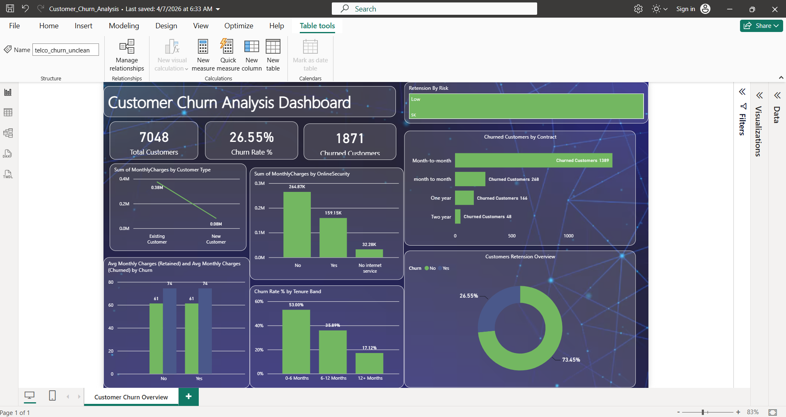

# Customer Churn Analysis – Power BI Practice Project

## 📊 Project Overview

This is a Power BI practice project created to understand customer churn and retention patterns.

The dashboard analyzes customer behavior and identifies patterns related to contracts, tenure, monthly charges, and online services.

## 🎯 Objective

The main objective of this project is to analyze customer churn and understand which customer segments show higher churn rates.

## 🛠️ Tools Used

- Power BI
- DAX
- Data Visualization

## 📈 Key Analysis

- Total Customers
- Churn Rate
- Churned Customers
- Customer Retention
- Churn by Contract Type
- Churn by Tenure
- Monthly Charges Analysis
- Online Security Analysis

## 📷 Dashboard Preview

## 📁 Project File

[Download Power BI Dashboard](Customer_Churn_Analysis.pbix)

## 📌 Project Type

Practice Project – Power BI
